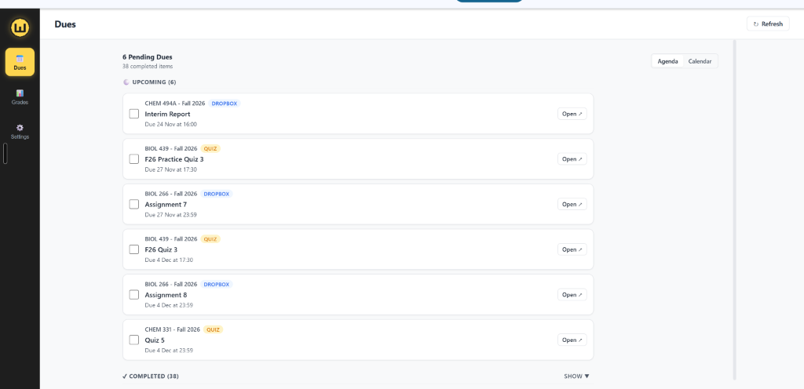
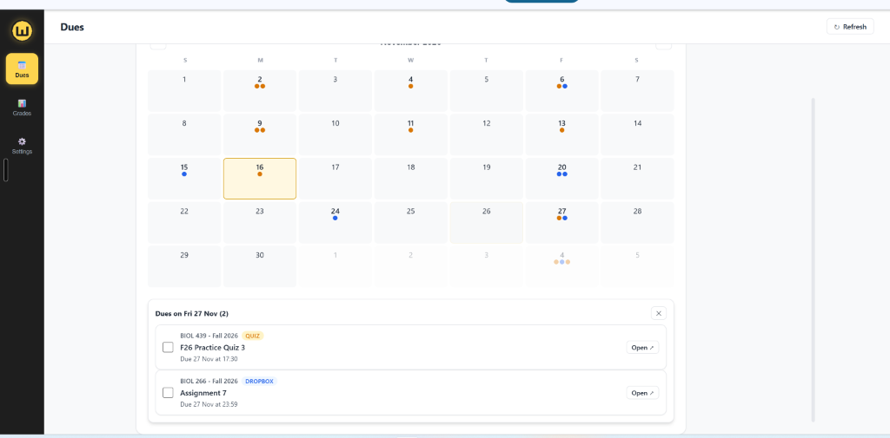
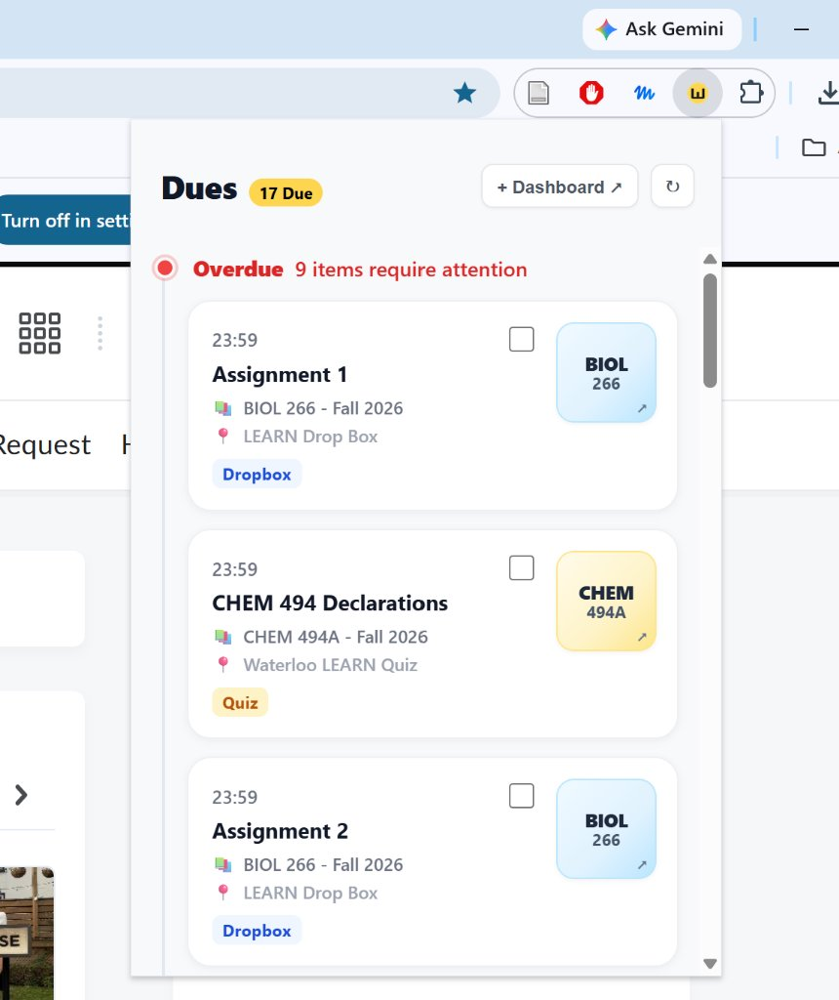

<div align="center">

  

  # WatToDue

  **The missing deadline & grade tracker for University of Waterloo LEARN.**

  [](https://blakejjia.github.io/WatToDue/)
  [](https://github.com/blakejjia/WatToDue/releases/latest)
  [](manifest.json)
  [](tests/)

  <br>

  <p align="center">
    <b>No more clicking through 5 different course shells just to find out what's due tonight.</b><br>
    WatToDue pulls all your dropboxes, quizzes, and grade breakdowns into one unified schedule.
  </p>

  [**🌐 Live Demo**](https://blakejjia.github.io/WatToDue/) • [**📦 Download ZIP**](https://github.com/blakejjia/WatToDue/releases/latest) • [**⚡ Quick Install**](#-quick-install-30-seconds)

</div>

<br>

---

## ⚡ What it Solves

| Without WatToDue 😫 | With WatToDue 😎 |
| :--- | :--- |
| Clicking through each course shell individually | **One unified agenda** across all your enrolled courses |
| Mystery `0 / 10` placeholders making your average look failing | **Real current average** computed only on marked work |
| Wondering if you already submitted a quiz | **Auto-detects submitted dropboxes & completed attempts** |
| Opening LEARN just to check a submission time | **1-click toolbar popup** with instant due countdowns |
| Labs, lectures, and test slots lumped together | **Smart tags**: distinguishes `LEC`, `LAB` (e.g. `CHEM 220L`), and `TUT` |

---

## 📸 In Action

### 1. Agenda View — All Deadlines, One Timeline
Grouped chronologically with color-coded pills (`Dropbox` vs `Quiz`) and deep links straight to the submission box.



---

### 2. Full Month Calendar Matrix
Click any day with deadlines to open side-by-side cards with exact due times and status.



---

### 3. Real Gradebook (Matching LEARN)
Hierarchical categories with collapsible folders, exact weights, and links to quiz attempts. Unmarked future assignments never drag down your current grade.


---

### 4. 1-Click Toolbar Popup
Check what's urgent right from your browser toolbar without loading full LEARN pages.

<div align="center">
  
</div>

---

## 🚀 Quick Install (30 Seconds)

1. **Download**: Grab [`WatToDue-v1.0.0.zip`](https://github.com/blakejjia/WatToDue/releases/latest) and unzip it.
2. **Open Chrome**: Navigate to `chrome://extensions` and toggle **Developer mode** (top right).
3. **Load**: Click **Load unpacked** (top left) and select the unzipped folder.
4. **Pin & Go**: Pin WatToDue to your toolbar, log into [Waterloo LEARN](https://learn.uwaterloo.ca), and click the icon!

---

## 🔒 Privacy & Safety

- **100% Local**: Runs entirely in your browser.
- **Zero External Requests**: Only talks to `https://learn.uwaterloo.ca`.
- **No Password Stored**: Uses your existing ambient browser session cookie.
- **No Tracking**: Zero analytics, zero telemetries, zero third-party scripts.

---

## 🛠️ For Developers

```bash
# Run test suite (32 unit tests)
npm test

# Build release package
npm run pack
```

---

<div align="center">
  <sub>Built with 💛 by Waterloo students, for Waterloo students. MIT Licensed.</sub>
</div>
