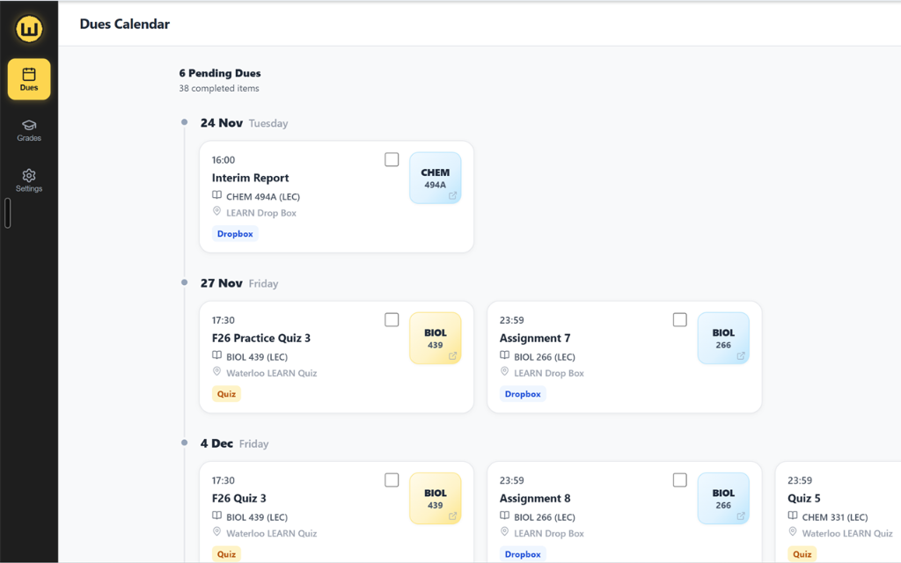
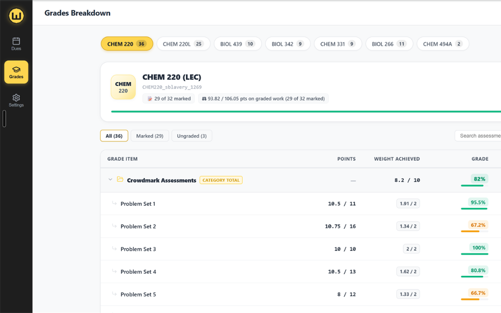

<div align="center">

  

  # WatToDue

  ### Never miss a Waterloo deadline again.

  [](https://chromewebstore.google.com/detail/wattodue-waterloo-learn-d/bpigocbcnijjmncfgdloeillfmifcemn)
  [](https://jia-yx.com/projects/wattodue/)
  [](https://jia-yx.com/projects/wattodue/)
  [](https://chromewebstore.google.com/detail/wattodue-waterloo-learn-d/bpigocbcnijjmncfgdloeillfmifcemn)
  [](tests/)

  <p align="center">
    <b>Consolidates assignment dropboxes, quizzes, and grade trees across all your Waterloo LEARN courses into one clean, high-performance dashboard.</b>
  </p>

  [**⚡ Install from Chrome Web Store**](https://chromewebstore.google.com/detail/wattodue-waterloo-learn-d/bpigocbcnijjmncfgdloeillfmifcemn) • [**📱 View on Google Play Store**](https://jia-yx.com/projects/wattodue/) • [**🌐 Live Web Showcase**](https://jia-yx.com/projects/wattodue/) • [**📦 Download ZIP**](https://github.com/blakejjia/WatToDue/releases/latest)

</div>

<br>

<div align="center">
  
  <p><sub><i>📅 Unified Dues Timeline across all Waterloo LEARN courses</i></sub></p>
  <br>
  
  <p><sub><i>📊 Accurate Hierarchical Grades Breakdown & Category Weighting</i></sub></p>
</div>

<br>

---

### 💡 Why WatToDue?

| Pain Point in LEARN 😫 | With WatToDue 🚀 |
| :--- | :--- |
| Clicking through 5 separate course shells every morning | **Unified Chronological Timeline** across all enrolled courses |
| Mystery `0 / 10` placeholders tanking your average | **True Standing**: Unmarked items displayed as *Ungraded* (`—`) |
| Wondering if your dropbox submission went through | **Auto-detects submitted files & finished quiz attempts** |
| Opening a heavy tab just to see what's due tonight | **1-Click Toolbar Popup** with instant countdowns |
| Confusing lab and lecture sections | **Smart Classification**: Auto-tags `LEC`, `LAB` (e.g. `CHEM 220L`), `TUT`, `TST` |
| Eye-straining bright white screens at 2 AM | **Dual Themes**: System Auto, Pure Dark Mode & Crisp Light Mode |

---

### ✨ Core Capabilities

- 📅 **Dual Visualizations**: Switch seamlessly between a chronological Luma-style **Agenda Timeline** and an interactive **Monthly Calendar Matrix**.
- 📊 **Real Gradebook Hierarchy**: Matches Waterloo LEARN's exact category weights and folder structures. Unmarked future assignments never drag down your standing.
- 🌓 **Theme Engine**: Complete dual Light & Dark mode support that adapts to your OS preference with 1-click manual overrides in Settings.
- 🔒 **Privacy-First Architecture**: 100% client-side. Zero analytics, zero telemetry, and zero credentials stored. Everything stays strictly inside your browser.

---

### 🚀 1-Click Install & Live Demo

1. **Chrome Web Store**: Open the [**WatToDue page on Chrome Web Store**](https://chromewebstore.google.com/detail/wattodue-waterloo-learn-d/bpigocbcnijjmncfgdloeillfmifcemn) and click **Add to Chrome**. *(Note: If Chrome shows a standard "Proceed with caution" prompt for new developer accounts, simply click **Continue to install**)*.
2. **Google Play Store**: [**View on Google Play Store**](https://jia-yx.com/projects/wattodue/) for mobile availability and updates.
3. **Live Showcase**: Visit our self-hosted demo at [**jia-yx.com/projects/wattodue/**](https://jia-yx.com/projects/wattodue/).
4. Pin WatToDue to your browser toolbar and visit [Waterloo LEARN](https://learn.uwaterloo.ca)!

> **Manual Developer Install**: You can also download the standalone [`WatToDue-v1.0.1.zip`](https://github.com/blakejjia/WatToDue/releases/latest) and load unpacked in `chrome://extensions`.

---

### 🛠️ Development & Testing

WatToDue is built with pure Vanilla JavaScript (ES Modules) and Chrome Manifest V3. No bundling or heavyweight framework overhead.

```bash
# Run the complete test suite (32 tests)
npm test

# Build production zip package in dist/
npm run pack
```

---

<div align="center">
  <sub>Built with 💛 by Waterloo students for Waterloo students. Not officially affiliated with Desire2Learn or the University of Waterloo.</sub>
</div>
