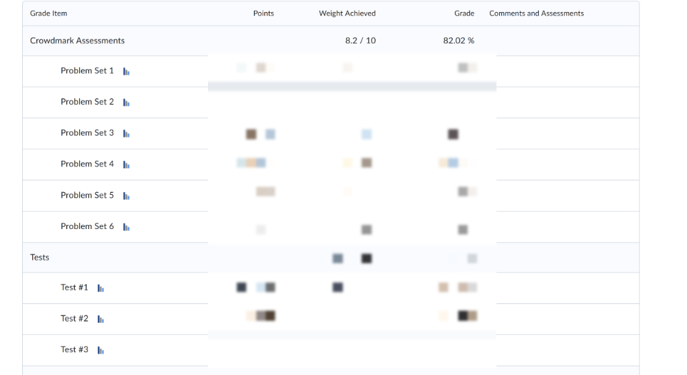
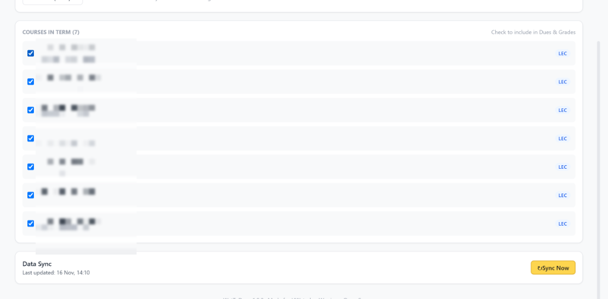

# WatToDue 🦅

> **Consolidated Deadlines Calendar and Gradebook Extension for University of Waterloo LEARN (D2L Brightspace).**

[](https://blakejjia.github.io/WatToDue/)
[](https://github.com/blakejjia/WatToDue)
[](https://uwaterloo.ca)
[](tests/)
[](LICENSE)

WatToDue brings all your assignment dropboxes, quizzes, and grade feedback into one clean, modern dashboard and quick toolbar popup right inside Google Chrome.

🌐 **Visit the Live Showcase Website**: [https://blakejjia.github.io/WatToDue/](https://blakejjia.github.io/WatToDue/)

---

## 📸 Screenshots Showcase

### 1. Dashboard Agenda & Deadlines Timeline
Date-grouped timeline with multi-card layout and automatic submission tracking:


### 2. Full Monthly Calendar Matrix
Explore deadlines day-by-day with interactive flyouts and color-coded status badges:


### 3. Waterloo LEARN Gradebook Tree & True Average
Exact Waterloo LEARN category hierarchy with collapsible folders and zero-score placeholder masking:


### 4. 1-Click Quick Toolbar Popup
Stay on top of upcoming and overdue tasks without ever leaving your active tab:
<p align="center">
  
</p>

### 5. Smart Course & Component Manager
Automatically recognizes Lectures (`LEC`), Laboratories (`LAB` e.g. `CHEM 220L`), Tutorials (`TUT`), and Tests (`TST`):


---

## ✨ Key Features

- 📅 **Consolidated Dues Calendar & Agenda**:
  - Automatically pulls deadlines across all your enrolled courses for the active term.
  - Visual color-coding: **Blue** for Assignment Dropboxes, **Amber** for Quizzes.
  - Relative timing badges: `🔴 Overdue`, `🟡 Due Today`, `🟢 Due Tomorrow`, `⚪ Upcoming`.
  - Automatic completion matching: Submitted dropboxes and attempted quizzes are automatically detected and marked as done.
  - One-click deep links: Jump directly to the specific submission folder or quiz in LEARN.

- 📊 **Gradebook & Category Tree**:
  - Matches the exact category tree hierarchy in Waterloo LEARN (`Problem Sets`, `Tests`, `Reflections`, `Quizzes`).
  - **No False 0% Failing Marks**: Unreleased and future assessments with 0 points are masked as `—` (Ungraded) so your true average is accurately calculated.
  - Deep links to view quiz attempts and instructor comments.

- 🔬 **Intelligent Course & Component Classification**:
  - Automatically detects Waterloo laboratory courses ending in `L` (e.g. `CHEM 220L`, `BIOL 240L`, `PHYS 121L`) with dedicated green `LAB` badges.
  - Filters out or enables tutorials (`TUT`) and test slots (`TST`) on demand.

- 🔒 **Privacy-First & 100% Client-Side**:
  - Runs entirely locally inside your browser via Chrome Manifest V3.
  - No external backend, no accounts, and no data tracking.
  - Uses ambient session cookies with `https://learn.uwaterloo.ca` — your credentials never leave your machine.

---

## 🚀 Installation Guide

### Option 1: Install from Release ZIP (30 Seconds)

1. Go to the [WatToDue Releases Page](https://github.com/blakejjia/WatToDue/releases/latest) and download `WatToDue-v1.0.0.zip`.
2. Unzip the file into a folder on your computer.
3. In Google Chrome, go to:
   ```text
   chrome://extensions
   ```
4. In the top-right corner, toggle **Developer mode** to **ON**.
5. Click **Load unpacked** in the top-left toolbar and select the unzipped WatToDue folder.
6. Pin **WatToDue** to your Chrome toolbar, log in to [Waterloo LEARN](https://learn.uwaterloo.ca), and click the icon to sync!

---

### Option 2: Build from Source

```bash
# 1. Clone the repository
git clone https://github.com/blakejjia/WatToDue.git
cd WatToDue

# 2. Run unit tests
npm test

# 3. Package the extension for release
npm run pack
```
This produces `dist/WatToDue-v1.0.0.zip` ready for loading into Chrome or publishing to the Chrome Web Store.

---

## 🤖 Continuous Integration & Deployment

- **One-Click Package & Release**: The `.github/workflows/package-extension.yml` workflow allows building and downloading the extension zip anytime from the GitHub Actions tab.
- **GitHub Pages Showcase**: The `.github/workflows/deploy-pages.yml` workflow automatically publishes the static showcase site at `https://blakejjia.github.io/WatToDue/` on every push to `main`.

---

## 📄 License

MIT License. Built with 💛 for University of Waterloo students.
